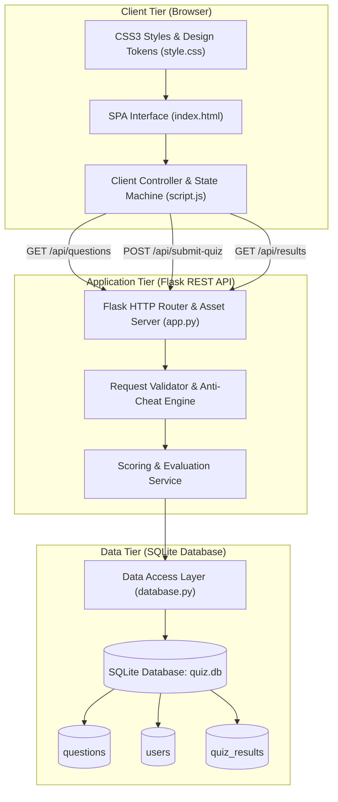
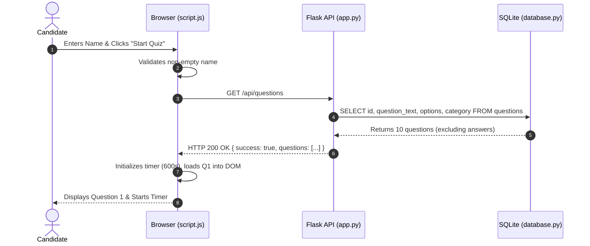
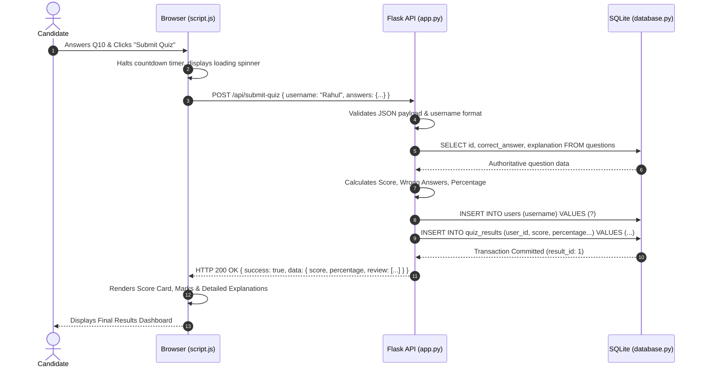

# System Architecture & Component Design (ARCHITECTURE.md)

## Project: Online Quiz Application
* **Architectural Pattern:** Model-View-Controller (MVC) / 3-Tier Layered Architecture
* **Target Platform:** Desktop, Tablet, and Mobile Web Browsers
* **Primary Runtime:** Python 3.8+ (WSGI) + Modern Web Standards (HTML5 / ES6+)

---

## 1. High-Level Architectural Overview

The **Online Quiz Application** adopts a decoupled **3-Tier Architecture** consisting of:
1. **Presentation Tier (Client-Side)**: Single Page Application (SPA) driven by HTML5, CSS3, and Vanilla JavaScript.
2. **Application / Business Logic Tier (Server-Side)**: Lightweight Python Flask REST API responsible for routing, request validation, timing verification, and automated evaluation.
3. **Data Persistence Tier (Storage)**: Embedded SQLite database (`quiz.db`) accessed via Python's standard `sqlite3` library with parameterized queries and transactional integrity.

---

## 2. Tier Details & Responsibilities

### 2.1 Presentation Tier (Frontend)
The frontend operates as a stateful Single Page Application (SPA) without full-page reloads:
* **`index.html`**: Defines semantic sections (`#start-screen`, `#quiz-screen`, `#result-screen`, and `#history-modal`).
* **`style.css`**: Provides responsive styling using modern CSS custom properties (`--primary`, `--radius-lg`, etc.), flexbox/grid layouts, micro-animations, and high-contrast accessibility rules.
* **`script.js`**: Manages the application lifecycle:
  * Manages UI state transitions between screens.
  * Enforces candidate name validation before quiz start.
  * Controls the 10-minute countdown clock using non-blocking asynchronous timers.
  * Maintains single-option selection integrity per question.
  * Dispatches HTTP REST requests via the native browser `fetch` API.
  * Renders dynamic question cards, review items, and historical attempt tables.

### 2.2 Application Tier (Flask Server)
The backend is structured around clean RESTful principles:
* **`app.py`**:
  * **Static File Dispatcher**: Serves `index.html`, `style.css`, and `script.js` at root paths.
  * **Endpoint Controller**: Exposes clean JSON APIs (`/api/questions`, `/api/questions/<id>`, `/api/submit-quiz`, `/api/results`).
  * **Anti-Cheat Shield**: Filters database records before returning to the frontend—stripping out `correct_answer` and `explanation` attributes during examination.
  * **Evaluation Engine**: Compares client-submitted answers against database values, computing scores, wrong counts, and percentage marks on the server.

### 2.3 Data Tier (SQLite Database Engine)
* **`database.py`**:
  * Encapsulates connection lifecycle using `get_db_connection()` with `row_factory = sqlite3.Row`.
  * Enforces foreign key constraints via `PRAGMA foreign_keys = ON;`.
  * Seeds sample questions into `questions` table upon first startup.
  * Guarantees atomic writes using standard SQL transaction rollbacks.
  * Eliminates SQL injection vulnerabilities through 100% parameterized queries.

---

## 3. End-to-End Request-Response Lifecycles

### 3.1 Quiz Start & Question Retrieval Flow

### 3.2 Quiz Submission & Score Evaluation Flow

---

## 4. Security Architecture

1. **Anti-Cheat Perimeter**:
   Unlike simple client-side quiz applications where answers are stored in JavaScript arrays and can be inspected via Chrome DevTools or network interceptors, our application keeps answers strictly in `quiz.db`. The `GET /api/questions` endpoint filters out `correct_answer` before transmission.
2. **SQL Injection Defense**:
   All database queries in `database.py` use parameterized placeholders (`?`). No dynamic string concatenation is allowed.
3. **Cross-Site Scripting (XSS) Sanitization**:
   The frontend uses a custom `escapeHtml()` utility to sanitize all strings before injecting them into HTML template literals.
4. **Input Boundary Validation**:
   Backend enforces non-empty usernames, length bounds ($\le 60$ characters), and strict typing for question IDs and selected option values.
