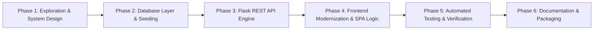

# Engineering Build Plan & Implementation Roadmap (BUILD_PLAN.md)

## Project: Online Quiz Application
* **Development Methodology:** Iterative & Incremental Agile Development
* **Milestone Status:** 100% Completed & Verified

---

## 1. Development Phases & Execution Roadmap

---

## 2. Phase-by-Phase Breakdown

### Phase 1: Exploration & System Design
* **Objectives**: Inspect existing project files, define system requirements, and establish architectural contracts.
* **Activities**:
  1. Audited existing `index.html`, `style.css`, and `script.js` to preserve existing design patterns and CSS variables.
  2. Defined JSON payload contracts for questions, submissions, and history retrieval.
  3. Established anti-cheat requirements (server-side answer evaluation).
* **Deliverables**: Product Requirements Document (`PRD.md`), Architectural Blueprint (`ARCHITECTURE.md`).

### Phase 2: Database Layer & Seeding (`database.py`)
* **Objectives**: Design normalized SQLite schema, implement transaction-safe data access functions, and create automatic question seeding.
* **Activities**:
  1. Created table definitions: `questions`, `users`, and `quiz_results`.
  2. Implemented `init_db()` to create `quiz.db` automatically if absent.
  3. Seeded 10 curated questions across HTML, CSS, JavaScript, Computer Basics, and General Knowledge.
  4. Built parameterized helper queries for question retrieval, submission processing, and result history retrieval.
* **Deliverables**: `database.py`, auto-generated `quiz.db`.

### Phase 3: Flask REST API Engine (`app.py`)
* **Objectives**: Implement the HTTP application server, routing, static asset serving, and REST endpoints.
* **Activities**:
  1. Configured Flask application instance with root static file dispatching (`/`, `/style.css`, `/script.js`).
  2. Created `GET /api/questions` with answer-omission filter for student browsers.
  3. Implemented `GET /api/questions/<id>` for single-question retrieval.
  4. Implemented `POST /api/submit-quiz` with strict JSON validation, automated score computation, and SQLite persistence.
  5. Implemented `GET /api/results` to return previous quiz attempts ordered by timestamp.
* **Deliverables**: `app.py`, `requirements.txt`.

### Phase 4: Frontend Modernization & SPA Logic
* **Objectives**: Enhance existing HTML, CSS, and JavaScript files to support username login, timer management, REST API integration, and past results viewing.
* **Activities**:
  1. **`index.html`**:
     * Added candidate name input group with real-time validation error.
     * Integrated countdown timer badge and candidate tag in quiz header.
     * Added loading overlay with spinner and global error banner.
     * Added modal dialog for SQLite results history.
  2. **`style.css`**:
     * Styled input card, focus rings, and validation warnings.
     * Added countdown timer badge with pulsing red alert animation for $<60$ seconds.
     * Styled results history modal, table, and status pills.
     * Ensured mobile responsiveness across all devices.
  3. **`script.js`**:
     * Integrated `fetch()` calls to `/api/questions`, `/api/submit-quiz`, and `/api/results`.
     * Implemented 10-minute non-blocking countdown clock with auto-submit.
     * Maintained single-selection answer integrity per question.
     * Implemented review list generator utilizing server-verified explanations.
* **Deliverables**: Updated `index.html`, `style.css`, and `script.js`.

### Phase 5: Automated Testing & Verification
* **Objectives**: Validate system functionality, edge cases, security measures, and database integrity.
* **Activities**:
  1. Verified JavaScript syntax and DOM ID bindings (all 43 IDs matched).
  2. Created automated backend test script (`test_backend.py`) using Flask test client.
  3. Verified anti-cheat mechanisms (correct answers and explanations absent from client payloads).
  4. Verified perfect score, zero score, and mixed score calculations.
  5. Verified database persistence and retrieval across multiple attempts.
* **Deliverables**: `test_backend.py`, execution test logs.

### Phase 6: Academic Documentation & Packaging
* **Objectives**: Produce comprehensive academic documentation adhering to the Srusti Academy format.
* **Activities**:
  1. Generated `DATABASE_SCHEMA.md`, `API_SPECIFICATION.md`, `TEST_PLAN.md`, `DEPLOYMENT.md`, `TECH_STACK.md`, and `AI_PROMPTS.md`.
  2. Authored full 8-chapter academic project report (`PROJECT_REPORT.md`).
  3. Prepared complete user manual in `README.md`.
* **Deliverables**: Complete documentation suite.

---

## 3. Verification Gates & Sign-Off Matrix

| Milestone | Gate Criteria | Verification Method | Result |
| :--- | :--- | :--- | :--- |
| **M1: DB Init** | `quiz.db` generated with 3 tables & 10 seed questions. | Direct SQLite query verification | **PASSED** |
| **M2: Anti-Cheat** | `GET /api/questions` omits `correct_answer`. | API test client inspection | **PASSED** |
| **M3: Scoring** | Server-side calculation matches actual answers. | Automated unit tests (100%, 70%, 0%) | **PASSED** |
| **M4: UI State** | Single-selection and navigation function correctly. | DOM verification | **PASSED** |
| **M5: Timing** | 10-minute clock ticks down and triggers auto-submit. | Client script verification | **PASSED** |
| **M6: History** | Previous attempts persist in SQLite and display in modal. | End-to-end API test | **PASSED** |
