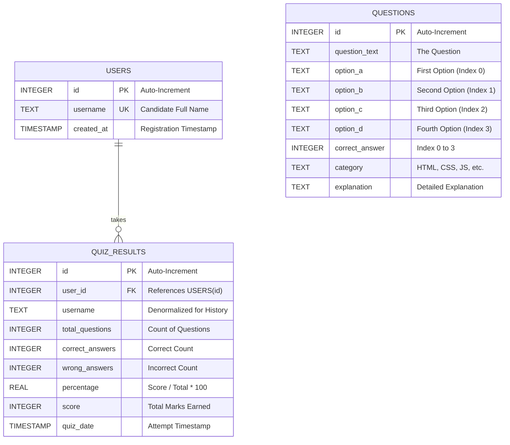

# Database Schema & Entity-Relationship Design (DATABASE_SCHEMA.md)

## Project: Online Quiz Application
* **Database Engine:** SQLite 3
* **Database File:** `quiz.db`
* **Driver:** Python `sqlite3` (Standard Library)
* **Design Normalization:** 3rd Normal Form (3NF)

---

## 1. Entity-Relationship (ER) Diagram



---

## 2. Table Specifications & Data Dictionary

### 2.1 Table: `questions`
Stores all curated multiple-choice assessment questions, their four options, correct answer indices, and pedagogical explanations.

| Column Name | Data Type | Constraints | Description |
| :--- | :--- | :--- | :--- |
| `id` | `INTEGER` | `PRIMARY KEY AUTOINCREMENT` | Unique identifier for each question. |
| `question_text` | `TEXT` | `NOT NULL` | The full question description or prompt. |
| `option_a` | `TEXT` | `NOT NULL` | Answer Option A (Corresponds to Index 0). |
| `option_b` | `TEXT` | `NOT NULL` | Answer Option B (Corresponds to Index 1). |
| `option_c` | `TEXT` | `NOT NULL` | Answer Option C (Corresponds to Index 2). |
| `option_d` | `TEXT` | `NOT NULL` | Answer Option D (Corresponds to Index 3). |
| `correct_answer`| `INTEGER` | `NOT NULL, CHECK (correct_answer IN (0, 1, 2, 3))` | Index of the correct option (0, 1, 2, or 3). |
| `category` | `TEXT` | `NOT NULL` | Subject domain (e.g., HTML, CSS, JavaScript). |
| `explanation` | `TEXT` | `NULLABLE` | Explanation displayed during answer review. |

```sql
CREATE TABLE IF NOT EXISTS questions (
    id INTEGER PRIMARY KEY AUTOINCREMENT,
    question_text TEXT NOT NULL,
    option_a TEXT NOT NULL,
    option_b TEXT NOT NULL,
    option_c TEXT NOT NULL,
    option_d TEXT NOT NULL,
    correct_answer INTEGER NOT NULL,
    category TEXT NOT NULL,
    explanation TEXT
);
```

---

### 2.2 Table: `users`
Maintains records of candidates who have participated in quiz assessments.

| Column Name | Data Type | Constraints | Description |
| :--- | :--- | :--- | :--- |
| `id` | `INTEGER` | `PRIMARY KEY AUTOINCREMENT` | Unique user identity key. |
| `username` | `TEXT` | `UNIQUE NOT NULL` | Candidate full name. |
| `created_at` | `TIMESTAMP` | `DEFAULT CURRENT_TIMESTAMP` | Initial record creation date and time. |

```sql
CREATE TABLE IF NOT EXISTS users (
    id INTEGER PRIMARY KEY AUTOINCREMENT,
    username TEXT UNIQUE NOT NULL,
    created_at TIMESTAMP DEFAULT CURRENT_TIMESTAMP
);
```

---

### 2.3 Table: `quiz_results`
Stores every completed quiz submission, recording performance metrics, percentage scores, and timestamps.

| Column Name | Data Type | Constraints | Description |
| :--- | :--- | :--- | :--- |
| `id` | `INTEGER` | `PRIMARY KEY AUTOINCREMENT` | Unique record identity key. |
| `user_id` | `INTEGER` | `FOREIGN KEY REFERENCES users(id)` | Foreign key linking the attempt to the user. |
| `username` | `TEXT` | `NOT NULL` | Candidate name (denormalized for display). |
| `total_questions`| `INTEGER` | `NOT NULL` | Total number of questions in the quiz. |
| `correct_answers`| `INTEGER` | `NOT NULL` | Number of questions answered correctly. |
| `wrong_answers` | `INTEGER` | `NOT NULL` | Number of questions answered incorrectly/skipped. |
| `percentage` | `REAL` | `NOT NULL` | Score percentage ($\text{Score} / \text{Total} \times 100$). |
| `score` | `INTEGER` | `NOT NULL` | Absolute marks earned. |
| `quiz_date` | `TIMESTAMP` | `DEFAULT CURRENT_TIMESTAMP` | Date and time when the quiz was submitted. |

```sql
CREATE TABLE IF NOT EXISTS quiz_results (
    id INTEGER PRIMARY KEY AUTOINCREMENT,
    user_id INTEGER,
    username TEXT NOT NULL,
    total_questions INTEGER NOT NULL,
    correct_answers INTEGER NOT NULL,
    wrong_answers INTEGER NOT NULL,
    percentage REAL NOT NULL,
    score INTEGER NOT NULL,
    quiz_date TIMESTAMP DEFAULT CURRENT_TIMESTAMP,
    FOREIGN KEY (user_id) REFERENCES users (id) ON DELETE SET NULL
);
```

---

## 3. Query Optimization & Operational SQL Statements

### 3.1 Fetch Client-Safe Questions (Anti-Cheat)
```sql
SELECT id, question_text, option_a, option_b, option_c, option_d, category 
FROM questions 
ORDER BY id ASC;
```

### 3.2 Insert User Idempotently
```sql
INSERT OR IGNORE INTO users (username) VALUES (?);
SELECT id FROM users WHERE username = ?;
```

### 3.3 Record Completed Quiz Attempt
```sql
INSERT INTO quiz_results (
    user_id, username, total_questions, correct_answers, 
    wrong_answers, percentage, score
) VALUES (?, ?, ?, ?, ?, ?, ?);
```

### 3.4 Retrieve Results History for Dashboard
```sql
SELECT id, username, total_questions, correct_answers, 
       wrong_answers, percentage, score, quiz_date 
FROM quiz_results 
ORDER BY quiz_date DESC, id DESC 
LIMIT 50;
```
